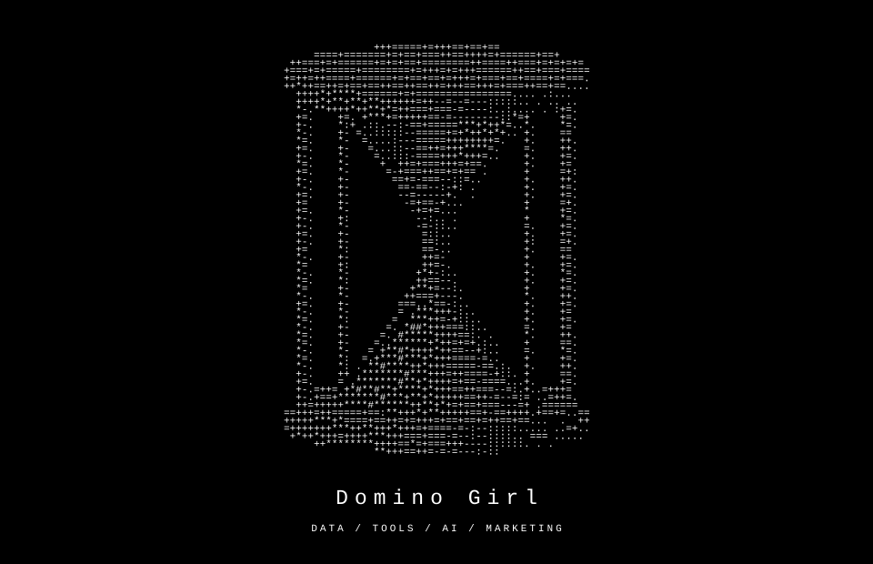

  <a href="https://github.com/0xDominoGirl/selected-work">
  <picture>
    <source media="(prefers-color-scheme: dark)" srcset="assets/hourglass-dark.svg">
    <source media="(prefers-color-scheme: light)" srcset="assets/hourglass-light.svg">
    
  </picture>
  </a>

<h2>About me &nbsp;<a href="https://x.com/0xDominoGirl" aria-label="Domino Girl on X"><picture><source media="(prefers-color-scheme: dark)" srcset="assets/x-dark.svg"><source media="(prefers-color-scheme: light)" srcset="assets/x-light.svg"></picture></a></h2>

I'm **Domino Girl**, a data analyst and aspiring founder. I've been freelancing since early 2026, building tools for DeFi and marketing through vibe coding.

I'm passionate about being at the forefront of AI and building useful products that solve real problems.
